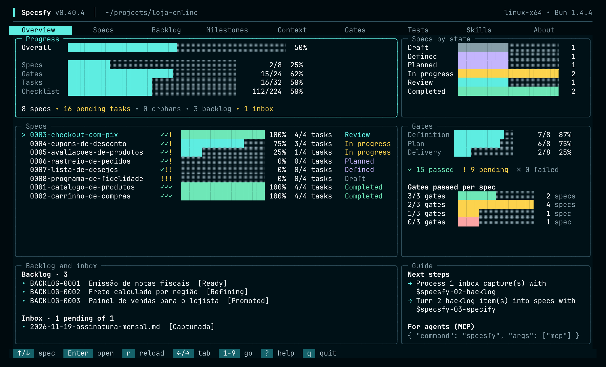
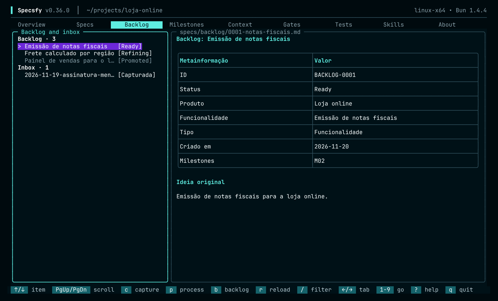
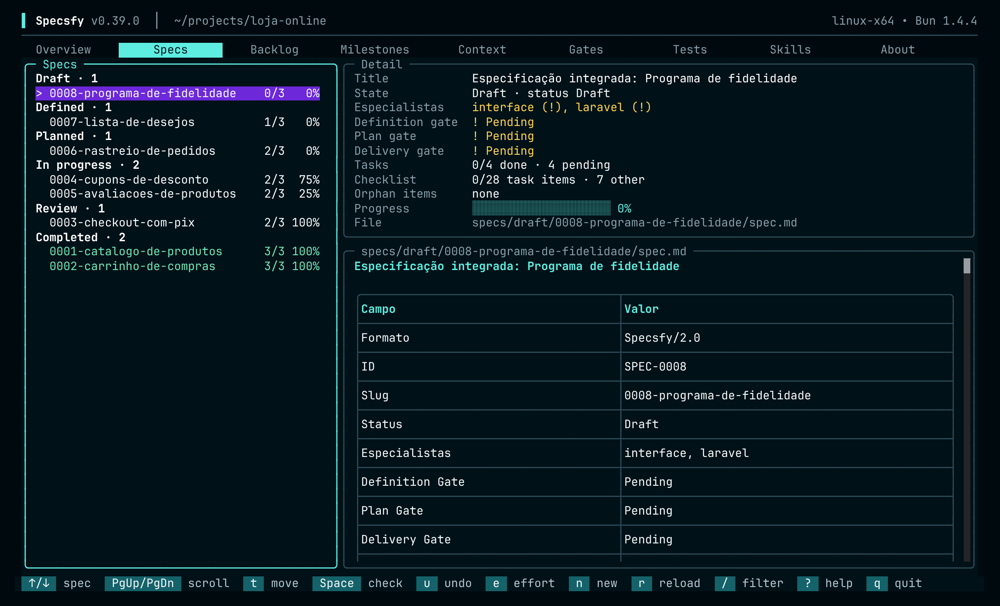
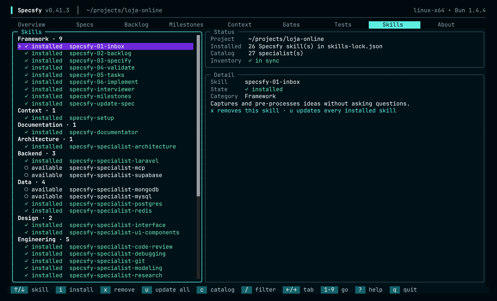

# CLI e TUI do Specsfy

O `specsfy` é um binário compilado em Bun. Ele instala e atualiza o framework,
move specs pelo ciclo, roda os gates, mantém o contexto do projeto, executa os
testes detectados e abre a TUI no terminal. O binário embute as skills e os
scripts do framework, portanto não exige Node.js nem Bun instalados na máquina.

Instale primeiro o CLI e o framework seguindo o
[guia de instalação](installation.md). Este guia assume que `specsfy --version`
já responde no terminal e que o framework foi publicado no projeto consumidor.
Para conduzir a primeira fatia depois da instalação, siga o
[guia do primeiro projeto](getting-started.md). Para seleção técnica, automação
e reabertura de gates, consulte o [uso avançado](advanced-usage.md).
Para cada argumento, opção, efeito e formato de saída, use a
[referência dos comandos](cli-reference.md).

Os templates de ideia, backlog, spec, tarefas e informações permanentes ficam
em `.specsfy/templates/`. Customizações com o mesmo nome ficam em
`.specsfy/templates/custom/` e têm precedência sobre os arquivos padrão. Ao
criar uma especificação, `specsfy specs new` renderiza o template resolvido em
`specs/draft/<NNNN>-<slug>/spec.md`. O cabeçalho renderizado é uma tabela
Markdown de duas colunas, `Campo` e `Valor`, com um metadado por linha.

## Instalação e atualização

Baixe o binário da plataforma em `get.specsfy.dev` ou instale pelo npm:

```bash
npm install --global @promovaweb/specsfy
specsfy --version
```

O pacote npm e o lançador de `get.specsfy.dev` são arquivos em Node.js (18 ou
superior) que baixam e conferem o binário da plataforma na primeira execução.
Para dispensar o Node.js, baixe o executável da GitHub Release.

Depois de instalar o programa, prepare o projeto consumidor:

```bash
specsfy doctor --project .
specsfy install --project . --detected
```

Para atualizar o framework do projeto, use `specsfy update`. Para trocar o próprio
binário pela última release, use `specsfy upgrade`:

```bash
specsfy update --project .
specsfy upgrade
specsfy upgrade --check
```

`specsfy update` deixa o projeto igual ao inventário do framework: instala as
skills que faltam, atualiza as que mudaram e remove as renomeadas e as
aposentadas. Alteração sua é mantida, salvo com `--force`; `--check` só mostra o
plano. Depois de um `specsfy upgrade`, rode `specsfy update` em cada projeto. A
TUI aberta avisa no cabeçalho `• vX.Y.Z installed: press q and reopen` e precisa
ser reaberta; o `specsfy mcp` segue na versão antiga até o agente reiniciar o MCP.

## Skills e especialistas

O comando `install` publica as bases, os templates e os especialistas detectados:

```bash
specsfy install --project . --detected
specsfy install --project . \
  --specialist specsfy-specialist-laravel,specsfy-specialist-postgres
```

`--specialist` recebe uma lista separada por vírgulas; repetida, só a última
vale. Depois da instalação inicial, os subcomandos de `skills` gerenciam o catálogo:

```bash
specsfy skills list
specsfy skills detect --project .
specsfy specialists suggest 0001
specsfy skills install specsfy-specialist-laravel --project .
specsfy skills remove specsfy-specialist-laravel --project .
specsfy skills update --project .
```

`specialists suggest` aceita número, slug ou caminho e mostra sinal, modo
quando houver, declaração e instalação, também com `--json`. `skills install`,
`skills remove` e `skills update` alteram o projeto. Skills externas ou com
alterações locais exigem `--force` para remoção.

## Ciclo da spec

O ciclo canônico é `draft`, `defined`, `planned`, `in-progress`, `review` e
`completed`. A transição atualiza o `Status` e os vínculos do backlog:

```bash
specsfy specs list
specsfy specs show 0001 --content
specsfy specs transition 0001 defined --project .
specsfy specs transition 0001 planned --project .
specsfy specs transition 0001 in-progress --project .
specsfy specs transition 0001 review --project .
specsfy specs transition 0001 completed --project .
```

O identificador da spec aceita número, nome da pasta, slug ou caminho. A raiz do
projeto vem de `--project <dir>`; sem a opção, o CLI usa o diretório atual e
sobe até a raiz mais próxima com `specs/`, `.specsfy/` ou `skills-lock.json`.
Specs nos layouts antigos, `specs/<slug>/` e `specs/specs/<slug>/`, mudam de
pasta com `specsfy specs migrate`.

Para abrir uma spec nova, use:

```bash
specsfy specs new --title "Recuperar senha" --project .
```

O comando aloca o próximo identificador e cria
`specs/draft/<NNNN>-<slug>/spec.md`. Para incorporar uma mudança tardia, consulte a
projeção de impacto sem editar a spec:

```bash
specsfy specs change 0001 --base HEAD --mode impact
specsfy specs research 0001
```

Para recalibrar a execução, registre o Effort e a justificativa:

```bash
specsfy specs effort 0001 7 \
  --reason "Inclui migração e integração externa." --project .
```

## Gates e verificação

Os gates usam o mesmo código de saída: `0` aprovado e `10` reprovado. O
resultado em texto lista os problemas; com `--json`, o campo `data` traz o
resultado estruturado.

```bash
specsfy gate spec 0001 --allow-draft
specsfy gate tasks 0001
specsfy gate interface 0001
specsfy gate trace 0001
specsfy gate acceptance 0001
specsfy gate evidence 0001 --delivery
specsfy gate findings 0001
specsfy gate database --project .
specsfy verify --boundary local
```

`specsfy verify` executa a política completa no terminal e no CI. A atestação
opcional registra o commit, os comandos aprovados e os arquivos cobertos.
Especialistas desconhecidos, ausentes ou sugeridos sem declaração aparecem
como avisos informativos. Em JSON, consulte `data.warnings`.

## Inbox e backlog

Uma captura entra na fila ativa com `inbox capture` e só sai depois que specs
aprovadas cobrem toda a solicitação:

```bash
specsfy inbox list
specsfy inbox capture \
  --input "Clientes ficam sem contexto quando a entrega atrasa." \
  --title "Avisar clientes sobre atrasos" \
  --summary "Notificar clientes afetados." \
  --problem "Falta de contexto durante atrasos." \
  --people "Clientes com entrega em andamento." \
  --value "Reduzir incerteza." \
  --signals "Canal sugerido: e-mail." \
  --review "Definir gatilho e conteúdo." \
  --project .
specsfy inbox process 2026-07-28-143205-recuperar-senha.md \
  --spec 0001 --project .
```

O processamento move a captura para `specs/inbox/processed/`, marca
`Status: Processada` e preserva o texto original. O backlog é refinado e
registrado com:

```bash
specsfy backlog list
specsfy backlog start \
  --title "Avisar clientes sobre atrasos" \
  --idea "Clientes ficam sem contexto quando a entrega atrasa." \
  --problem "Falta de contexto durante atrasos." \
  --person "Clientes com entrega em andamento." \
  --result "Reduzir incerteza." \
  --context "Durante a revisão semanal do produto." \
  --project .
```

## Tarefas e progresso

O plano vive dentro da spec. Estes comandos consultam a próxima tarefa,
marcam itens e projetam a entrega:

```bash
specsfy tasks next 0001
specsfy tasks check 0001 T001 PREP
specsfy tasks check 0001 T001 PREP --undo
specsfy tasks delivery 0001 --format markdown
specsfy progress
specsfy progress --spec 0001 --json
specsfy status
```

`tasks delivery` escreve somente em `stdout`, enquanto a publicação do texto depende
de uma solicitação explícita. `progress --watch` atualiza a cada mudança das specs e `--json`
entrega `summary` e `specs` para automação.

## Contexto do projeto

Os arquivos de contexto são mantidos por comandos:

```bash
specsfy context setup --project .
specsfy context inspect --project .
specsfy context interface --project .
specsfy context monitor --project . --check
specsfy context stack --project .
specsfy context rule --project . --section "Testes" --rule "Pest em PHP."
specsfy context database --project .
specsfy context data --project . --name "Pedido" --purpose "Acompanhar a entrega."
specsfy context usage 0001 --json
specsfy docs build --project .
specsfy docs build --project . --check
```

`context monitor --check` marca `status: pending` e sai com `10` quando um
documento derivado ficou desatualizado. `context usage` estima o custo de leitura de uma spec. `docs
build --check` sai com `10` quando a documentação está desatualizada.

## Milestones

```bash
specsfy milestones sync --project .
specsfy milestones import-mvp --project .
```

`milestones sync` projeta os vínculos das specs para `specs.md` e
`specs/milestones/MNN.md`, enquanto `milestones import-mvp` converte o `MVP.md`
em `M01`, itens de backlog e specs em Draft.

## Testes do projeto

O comando `test` detecta o runner da stack, transmite a saída e preserva o
código de saída:

```bash
specsfy test --project .
```

Em Laravel com Pest, ele chama `php artisan test`. Antes de iniciar o processo,
confere `.env.testing`, `APP_ENV=testing` e um banco de teste diferente do banco
de desenvolvimento. Comandos capazes de apagar estruturas são recusados.

## TUI

Execute sem argumentos dentro do projeto consumidor para abrir a TUI:

```bash
specsfy
```

Não é preciso escrever `tui`; `specsfy tui --project PATH` abre outro projeto. A TUI tem nove abas:

- **Overview**, painel das specs, gates, tarefas e checklist; `↑`/`↓` escolhem e `Enter` abre a spec selecionada.
- **Specs**, specs por estado, com gates, tarefas e o Markdown; `t` muda o estado, `Espaço` marca o próximo item, `u` desfaz a marcação, `e` registra o esforço e `n` cria uma spec.
- **Backlog**, itens do backlog e capturas do inbox; `c` captura, `p` processa a captura selecionada e `b` cria um item de backlog.
- **Milestones**, milestones de `specs/milestones/` com progresso e preview.
- **Context**, documentos de contexto do projeto, com `✓` quando existem.
- **Gates**, roda os gates da spec selecionada com `Enter`; `v` roda o `specsfy verify` do projeto.
- **Tests**, roda a suíte do projeto com `Enter`.
- **Skills**, skills instaladas e do catálogo; instala, remove e atualiza.
- **About**, identidade do binário, runtime, projeto, licença e créditos.

Cada ação pede confirmação ou texto e mostra o resultado no rodapé. Um clique seleciona o item de lista e abre a aba, e a roda rola listas e prévias.

Teclas globais: `←`/`→`, `[`/`]`, `Tab` e `1` a `9` mudam de aba; `/` filtra
a lista da tela (Enter mantém, `Esc` limpa) e `?` mostra o help de teclas.
`q`, `Esc` ou `Ctrl+C` saem. `--tab` ou `tui.initialTab` escolhem a aba
inicial. A TUI relê as specs a cada `tui.watchInterval` segundos (padrão
`0.75`) e usa `tui.theme`: `terminal` (tema do terminal), `night` ou `day`.

### Percurso visual

#### Overview: visão consolidada



A Overview é o painel de estatísticas: barra **Overall** com a média das specs,
medidores de specs, gates, tarefas e checklist, specs por estado, gates de cada
spec, backlog, inbox e próximo passo.

#### Backlog: lista e leitura lado a lado



A aba Backlog mantém a seleção à esquerda e mostra o Markdown do item na
direita, com as capturas do inbox na mesma lista.

#### Specs: gates, tarefas e progresso



A spec selecionada mostra gates, tarefas e especialistas declarados. A marca
`(!)` indica instalação ausente. `g` abre Gates e `r` recarrega.

#### Skills: instalar com confirmação



A aba Skills lista instaladas e catálogo por categoria, com o detalhe ao lado:
`i` instala, `x` remove, `u` atualiza todas e `c` baixa o catálogo, cada ação
com `y` para confirmar. Todas as telas estão no [showcase](../develop/showcase.md).

## Servidor MCP

O agente usa o mesmo binário pela entrada `mcp`:

```bash
specsfy mcp
```

A configuração do cliente MCP é:

```json
{
  "command": "specsfy",
  "args": ["mcp"]
}
```

O servidor expõe os commands como tools, entre elas `inbox_capture`,
`backlog_start`, `spec_create`, `spec_transition`, `spec_effort`, `task_next`,
`task_check`, `delivery_render`, `gate_spec`, `gate_tasks`, `gate_interface`,
`gate_trace`, `gate_acceptance`, `gate_evidence`, `gate_findings`,
`gate_database`, `verify`, `context_setup`, `context_inspect`,
`context_interface`, `context_monitor`, `context_stack`, `context_rule`,
`context_database`, `context_data`, `context_usage`, `docs_build`,
`milestones_sync` e `milestones_import_mvp`. O agente não precisa chamar script
algum.

## Documentação embutida

`specsfy --skill` imprime a documentação do framework embutida no binário, enquanto
`specsfy skill <tema>` mostra um tema específico. A mesma
documentação fica disponível pelo MCP no recurso `specsfy://skill`.

## Configuração e credenciais

As preferências ficam em `~/.specsfy/settings.json` e são lidas por:

```bash
specsfy config list
specsfy config get output.format
specsfy config set output.colors false
specsfy config unset output.colors
specsfy config path
specsfy config schema
```

Os segredos ficam cifrados em `~/.specsfy/credentials.json`:

```bash
specsfy credentials set github.token --stdin
specsfy credentials status
specsfy credentials list
specsfy credentials remove github.token
```

A credencial `github.token` é usada para consultar o catálogo e as releases.
`GH_TOKEN`, `GITHUB_TOKEN` e `gh auth token` continuam aceitos nesta ordem.

## Diagnóstico

`specsfy doctor` confere o runtime embutido, o terminal, as configurações, a
origem da chave e a leitura do cofre. `--project <dir>` acrescenta as checagens
do projeto, como `git`, o CLI de skills, o `skills-lock.json` e o token do GitHub. Qualquer
checagem reprovada produz código de saída `3`.

## Justificativa de tamanho

Comandos, TUI e MCP operam os mesmos arquivos e são apresentados juntos.

## Segurança e reversibilidade

- O destino padrão das skills é `<projeto>/.agents/skills`.
- O contrato central fica em `<projeto>/.specsfy/Spec.md`.
- Template e exemplo ficam em `<projeto>/.specsfy/templates/Spec.md` e
  `<projeto>/.specsfy/examples/Spec.md`.
- Templates personalizados ficam em `<projeto>/.specsfy/templates/custom/`, fora
  do lock e protegidos até mesmo de operações com `--force`.
- `AGENTS.md` e `CLAUDE.md` recebem somente blocos delimitados e atualizáveis.
- O registro fica em `<projeto>/.specsfy/skills-lock.json` e cada skill
  gerenciada registra um fingerprint de conteúdo.
- Uma execução repetida sobre a mesma versão não altera arquivos nem o lock.
- Alterações locais fazem a atualização e a remoção serem recusadas. Use
  `--force` somente depois de confirmar que a versão customizada pode ser
  descartada.
- `specsfy skills remove <nome>` remove somente o nome explícito e preserva
  conteúdo local divergente.
